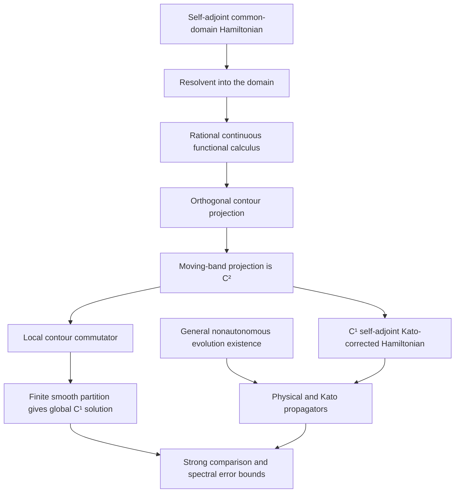

# Proof guide: quantum adiabatic theorem

The main result is the common-domain theorem for possibly unbounded
self-adjoint Hamiltonians on an arbitrary complex Hilbert space. It
constructs the spectral projection and strong Schrödinger evolution from
Hamiltonian and spectral-gap assumptions, then proves uniform
projection-distance and leakage bounds. Start with its statement and proof
below.

The original finite-dimensional theorem remains a separate result. It
takes smooth Hamiltonian and projection paths as input, uses a gap between
their spectral sectors, and proves a leakage bound. The bounded theorem
with a fixed resolvent circle is an intermediate spectral construction.
These declarations have different input structures.

| Result | Statement and proof | Guide section |
| --- | --- | --- |
| Full common-domain theorem | [Statement](../Adiabatic/Unbounded/Statement.lean), [main theorem](../Adiabatic/Unbounded/MainTheorem.lean) | [Common-domain argument](#full-common-domain-theorem) |
| Bounded theorem with a fixed circle | [Spectral theorem](../Adiabatic/Infinite/SpectralTheorem.lean) | [Bounded spectral argument](#bounded-spectral-theorem-in-arbitrary-dimension) |
| Original finite-dimensional theorem | [Statement](../Adiabatic/Statement.lean), [main theorem](../Adiabatic/MainTheorem.lean) | [Finite-dimensional argument](#original-finite-dimensional-theorem) |

See [Verification and scope](verification.md) for the verification record,
[Common-domain research](unbounded-research.md) for the literature
comparison, and [Possible extensions](extensions.md) for informal explicit
estimates outside the proved declarations. The [documentation index](README.md)
lists the other reading paths.

Throughout, $[A,B]=AB-BA$, products act on the rightmost vector first, and
$\hbar=1$. Time is $s\in[0,1]$ and the runtime is $T>0$. The Hamiltonian
path and selected band are fixed independently of $T$.

## Full common-domain theorem

The input structure in
[`Unbounded/Statement.lean`](../Adiabatic/Unbounded/Statement.lean) uses a
dense injective continuous inclusion $j:D\to E$, a complete domain space,
and a $C^2$ path $H:[0,1]\to B(D,E)$. Each represented unbounded operator is
equal to its actual adjoint. Continuous endpoints $a<b$ select a bounded
spectral band and stay a uniform positive distance from spectrum.

The theorem constructs a $C^2$ orthogonal spectral projection $P(s)$ and,
for each runtime $T>0$, strong unitary evolution with

$$
\begin{aligned}
\frac{d}{ds}\bigl(U_T(s)j\psi\bigr)&=-iT H(s)\widetilde U_T(s)\psi,\\
j\widetilde U_T(s)\psi&=U_T(s)j\psi,\qquad U_T(0)=I,\qquad\psi\in D.
\end{aligned}
$$

Both the evolution and its inverse preserve the whole common domain.
There is one $C\ge0$, independent of $T$, the chosen physical propagator,
and $s\in[0,1]$, such that

$$
\begin{aligned}
\|U_T(s)P(0)U_T(s)^*-P(s)\|&\le C/T,\\
\|(I-P(s))U_T(s)P(0)\|&\le C/T.
\end{aligned}
$$

The selected band may have infinite rank. The bound is in the physical
Hilbert-space operator norm; it does not require operator-norm continuity
of the physical evolution. The constant is existential. The full theorem
follows the dependency chain below.

### Domain-valued resolvents and projections

Write $R_D(z)=(H-zj)^{-1}:E\to D$ and $r(z)=jR_D(z)$. The two maps have
different types and norms. Their cancellation and resolvent identities are
proved in `Unbounded/Resolvent.lean`; `Domain.lean` proves equivalence with
the graph norm and uses full unbounded self-adjointness.

The physical projection and its lift are

$$
P=-\frac1{2\pi i}\oint r(z)\,dz,
\qquad
P_D=-\frac1{2\pi i}\oint R_D(z)\,dz.
$$

To identify this projection using bounded functional calculus, set $b=r(i)$
and use

$$
b((z-i)b-I)^{-1}=-r(z).
$$

The spectrum correspondence $w\mapsto i+w^{-1}$ for $w\ne0$ and the scalar
circle integral identify $P$ as the selected spectral cutoff of $b$.
The value at $w=0$ is zero. `Unbounded/RieszProjection.lean` derives
$P^2=P=P^*$, $jP_D=P$, and fixed-contour regularity in both operator norms.

### Continuously moving endpoints

The enclosing circle has center $(a+b)/2$ and radius $(b-a)/2$. Holding its
endpoints fixed near any given time preserves the selected part of the
current spectrum, because the moving endpoints change by less than the
gap. `ContourIndependence.lean` proves equality of projections selecting the
same spectral subset. `MovingBand.lean` uses this equality to prove $C^2$
regularity of $P$ and $P_D$. Differentiability of $a$ and $b$ is unnecessary.

### The global domain commutator

For $K=[P',P]$, a local contour gives

$$
X_D=-\frac1{2\pi i}\oint R_D(z)P'r(z)\,dz,
\qquad X=jX_D,
\qquad HX_Dj-XH=Kj.
$$

`RieszCommutator.lean` proves this identity on every domain vector and
establishes $C^1$ regularity. `SmoothGluing.lean` proves a finite smooth
partition-of-unity theorem for linear equations. `GlobalCommutator.lean`
applies it to the domain commutator; `GappedCommutator.lean` supplies the local
contours from the moving-band hypotheses. This constructs a global smooth
solution directly from the gap.

### Strong comparison and final reduction

The comparison calculation is made after application to domain vectors.
`StrongCalculus.lean` supplies the needed product rules under strong
continuity and uniform boundedness. `StrongEstimate.lean` extends the
resulting norm bound from the dense domain to the physical Hilbert space.
`Transport.lean` derives exact intertwining for the Kato evolution.

`GappedSpectralTheorem.lean` constructs the spectral inputs and proves both
projection distance and leakage with one constant $C$, conditional only on
the two strong propagators. `GappedReduction.lean` proves that the Kato
correction is $C^1$ and skew-adjoint. The bounded self-adjoint perturbation
$H+(i/T)Kj$ has the same full domain. Thus general $C^1$ common-domain
evolution existence supplies both propagators.

`commonDomainAdiabaticTheorem_of_evolution_existence` keeps the spectral
argument separate from general evolution theory. The declaration
`common_domain_evolution_existence` proves its existence hypothesis, and
`common_domain_adiabatic_theorem` applies the reduction. Both are in
[`Unbounded/MainTheorem.lean`](../Adiabatic/Unbounded/MainTheorem.lean).
The same module proves `GappedHamiltonian.exists_unique_unitary_evolution`,
with uniqueness on the unit interval among strong unitary common-domain
propagators.

### Autonomous and nonautonomous evolution

`ResolventApproximation.lean` constructs commuting bounded self-adjoint
approximations from nonreal resolvents. `Autonomous.lean` proves convergence
of their unitary exponentials to an actual autonomous group, including
domain preservation and the strong equation. These results are checked.

For time dependence, the construction composes autonomous groups for frozen
Hamiltonians. `GraphBounds.lean` controls products in shifted graph norms.
`RightPropagator.lean` handles right derivatives at partition boundaries;
`Nonautonomous.lean` develops comparison and limit estimates.
`NonautonomousDomain.lean` recovers membership in the common domain from
graph bounds, and `HilbertGraphConvergence.lean` upgrades the corresponding
continuity.

`FrozenApproximation.lean` assembles actual frozen evolutions, a vanishing
uniform coefficient error, and forward/inverse domain bounds from $C^1$
regularity and genuine self-adjointness. `GraphLimit.lean` transfers the
sharp two-time graph bound to the physical limit and proves continuity of
its domain lift. A local comparison with the autonomous group of $H(t)$
has an $O(|s-t|^2)$ remainder on every initial domain vector. Consequently,
the limit satisfies the strong equation, including the appropriate
one-sided derivatives at both endpoints.

`exists_nonautonomous_strongPropagator` in `Nonautonomous.lean` packages
these derived facts into the required strong propagator. It assumes no
auxiliary evolution, domain invariance, or graph estimate. This completes
the existence input used by the full adiabatic theorem. The final mechanical
build and transitive axiom audit are recorded in
[verification.md](verification.md).

## Bounded spectral theorem in arbitrary dimension

`Infinite/RieszProjection.lean` constructs a Riesz projection from a fixed
circle in the resolvent set. The scalar circle integral is evaluated first;
continuous functional calculus then proves that the operator integral is a
self-adjoint idempotent commuting with the Hamiltonian. Smoothness follows
from smooth inversion in the algebra of continuous operator-valued functions
on the circle and the continuity of contour integration.

`Infinite/RieszCommutator.lean` constructs the contour commutator and proves
its equation and regularity. `Infinite/Unitary.lean` constructs two-sided
unitary evolution without using finite-dimensional injectivity or
surjectivity. The final declaration is
`bounded_adiabatic_theorem_of_resolvent_contour` in
[`Infinite/SpectralTheorem.lean`](../Adiabatic/Infinite/SpectralTheorem.lean).
It proves existence and uniform leakage for a bounded self-adjoint $C^2$
Hamiltonian with one fixed isolating circle. A fixed circle is an explicit
assumption of this particular theorem.

## Original finite-dimensional theorem

### Statement and conventions

Let $E$ be a finite-dimensional complex Hilbert space, and use the
operator norm on $B(E)$. Time is the real variable $s\in[0,1]$; the runtime is
$T>0$. Set $\hbar=1$ and use $[A,B]=AB-BA$. Products are compositions,
with the rightmost operator acting first. The physical equation is

$$
U_T'(s)=-iT H(s)U_T(s),\qquad U_T(0)=I.
$$

The paths $H$ and $P$ are fixed independently of $T$.

**Formalized hypotheses.** Let $H,P:\mathbb R\to B(E)$ be globally $C^2$ paths.
For every real time, assume $H^*=H$, $P^*=P$, $P^2=P$, and $HP=PH$.

On $[0,1]$, assume a fixed $g>0$ separates every eigenvalue of $H$ in
$\operatorname{range}P$ from every eigenvalue in $\ker P$. This eigenvalue
formulation is the definition `HasUniformSpectralGap` in `Statement.lean`.

The selected subspace may have arbitrary rank, with eigenvalue crossings
inside either sector. The eigenvalue condition is vacuous for a trivial
projection, and the theorem includes those cases and the zero-dimensional
space. `MainTheorem.lean` constructs the physical evolution and proves that
there is a constant $C\ge0$, chosen before the runtime and the solution, such
that every physical solution satisfies, for every $T>0$ and $s\in[0,1]$,

$$
\|(I-P(s))U_T(s)P(0)\|\le C/T.
$$

`Schrodinger.lean` separately proves uniqueness on $[0,1]$ and unitarity.
The main theorem's conclusion is the operator leakage estimate above.

**Consequences and separate declarations.** Informally, a normalized
initial state in $\operatorname{range}P(0)$ has leakage probability at most
$C^2/T^2$. The comparison proof also gives

$$
\|U_T(s)P(0)U_T(s)^*-P(s)\|\le 2C/T.
$$

Here $C$ may be taken to be the comparison constant constructed in the proof;
the factor $2$ is not optimal. Formal probability and limit corollaries
remain extensions of this theorem. The generic projection-distance estimate
is proved in `ProjectionDistance.lean` and is used by the common-domain
theorem described above. The finite-dimensional theorem supplies both
smooth paths as input; contour construction of the projection is available
in the spectral modules. Its global regularity assumptions are stronger
than regularity on a neighborhood of $[0,1]$.

Jansen–Ruskai–Seiler state quantitative band versions and permit crossings
within the band; their Theorem 3 gives substantially sharper derivative and
gap dependence than the elementary constants in
[Possible extensions](extensions.md). Their convention for scaled
Schrödinger evolution agrees with the one above.
[Primary source, Sections II–III](https://arxiv.org/pdf/quant-ph/0603175).

### First intermediate theorem: actual evolution plus a commutator solution

The checked comparison estimate in `Comparison.lean` works in a complex
operator algebra without finite dimensionality. Its inputs are:

1. $U,V,X$ have real derivatives within the closed interval, including its
   endpoints.
2. $U,V$ are unitary, $U(0)=V(0)=I$, and
   $U'=-iTHU$, $V'=(-iTH+K)V$.
3. $H^*=H$, $K^*=-K$, and $[H,X]=K$ at each time.
4. Uniform bounds $\|X\|\le M_X$, $\|X'\|\le M_D$, and
   $\|K\|\le M_K$ hold. For a family of runtimes, these data and bounds
   are independent of $T$.

The intermediate conclusion is

$$
\|U(s)-V(s)\|
\le\frac{2M_X+s(M_D+M_KM_X)}{T}
\le\frac{2M_X+M_D+M_KM_X}{T}.
$$

This intermediate theorem assumes the commutator solution and the two
unitary evolutions. In the original finite-dimensional theorem,
`SpectralGap.lean` and `Regularity.lean` construct the solution from the gap;
`Propagator.lean` and `Transport.lean` construct the evolutions and derive
unitarity. The final estimate is never assumed.

#### Derivation with a corrected wave operator

The following calculation spells out the sign choices and reduces the proof
to ordinary derivative rules and a mean-value inequality. Define

$$
\Omega=V^*U,\qquad B=V^*XU,\qquad F=\Omega-\frac{i}{T}B.
$$

From the equations and the adjoint relations,

$$
(V^*)'=V^*(iTH-K),\qquad
\Omega'=-V^*KU,
$$

and hence

$$
\begin{aligned}
B'&=V^*(iTH-K)XU+V^*X'U-iT V^*XHU\\
  &=iT V^*[H,X]U+V^*(X'-KX)U\\
  &=iT V^*KU+V^*(X'-KX)U.
\end{aligned}
$$

Since $i^2=-1$, cancellation gives

$$
F'=-\frac{i}{T}V^*(X'-KX)U.
$$

Unitary invariance and submultiplicativity imply

$$
\|F'(s)\|\le (M_D+M_KM_X)/T.
$$

The mean-value inequality bounds $\|F(s)-F(0)\|$ by $s$ times this quantity.
Using $\Omega(0)=I$, $\|B(s)\|\le M_X$, and $\|B(0)\|\le M_X$ gives the
estimate for $\Omega-I$; multiplication by $V$ gives the estimate for $U-V$.
This is the implementation in `Evolution.lean` and `Bounds.lean`.

This argument is a mean-value implementation of the commutator method.
Avron–Elgart's Lemma 1 allows an additional commutator residual and uses
integration by parts to estimate the evolution difference. Its gap case has
zero residual and yields inverse-runtime convergence.
[Primary source, Section 4](https://arxiv.org/pdf/math-ph/9805022).

### Second intermediate theorem: Kato transport

Let $P$ be a differentiable orthogonal projection path, and write
$D=P'$, $Q=I-P$, and $K=DP-PD$. Differentiating $P^2=P$ yields

$$
DP+PD=D,\quad PDP=0,\quad QDQ=0,\quad [K,P]=D.
$$

Real differentiation of $P^*=P$ gives $D^*=D$, so $K^*=-K$. If $HP=PH$, the
derivative of $V^*PV$ for the adiabatic evolution is

$$
(V^*PV)'=V^*(D+PK-KP) V=0.
$$

Its initial value is $P(0)$. Thus $P(s)V(s)=V(s)P(0)$, as proved from the
differential equation in `Transport.lean`. It follows that

$$
Q(s)U(s)P(0)=Q(s)(U(s)-V(s))P(0).
$$

Orthogonal projections are contractions, giving the checked leakage bound
in `Leakage.lean`. For the checked projection-distance estimate, expand the
difference between $UP(0)U^*$ and $VP(0)V^*$ into two terms, each bounded by
$\|U-V\|$.

### Constructing the commutator solution from the gap

#### General spectral cluster: an inverse on a fixed operator space

The proof defines superoperators on the fixed vector space $B(E)$:

$$
\begin{aligned}
O_P(A)&=PAQ+QAP,\\
D_P(A)&=PAP+QAQ,\\
\mathcal L_{H,P}(A)&=D_P(A)+[H,O_P(A)].
\end{aligned}
$$

Because $HP=PH$, the commutator preserves diagonal and off-diagonal blocks.
On diagonal blocks $\mathcal L$ is the identity. Its kernel therefore
consists of off-diagonal operators commuting with $H$. In `SpectralGap.lean`,
sector separation shows that such an operator annihilates every vector in
an orthonormal eigenbasis of $H$. Hence the kernel is zero, and finite
dimensionality gives invertibility. This uses an eigenbasis only at a fixed
time; no differentiable eigenvector choice is required. Set

$$
X=\mathcal L_{H,P}^{-1}(K).
$$

Since $K$ is off-diagonal, $X$ is off-diagonal and $[H,X]=K$.
The paths $\mathcal L$ and $K$ are $C^1$ when $H$ is $C^1$ and $P$ is $C^2$.
Smooth inversion gives $X\in C^1$. `Regularity.lean` proves these claims
within the unit interval and obtains finite bounds on $X$, $X'$, and $K$
by compactness. The bounds are independent of $T$.

Explicit gap dependence is discussed separately in
[Possible extensions](extensions.md#general-spectral-cluster-estimate).

#### Reduced resolvent algebra

For one isolated eigenvalue, possibly degenerate, assume $HP=eP$ for a real
$C^2$ function $e$, with the complement at distance at least $g$ from $e$.
Put

$$
A=H-eI+P,\qquad R=A^{-1}-P.
$$

Given the augmented inverse, `ReducedResolvent.lean` proves $RP=PR=0$ and
$(H-eI)R=R(H-eI)=Q$. It also proves that

$$
X=RDP+PDR.
$$

solves $[H,X]=DP-PD$. This algebraic special case is independent of the
general-cluster proof used in the main theorem.

The proposed derivative formula and explicit constants are collected in
[Possible extensions](extensions.md#reduced-resolvent-estimates). They are
separate from these algebraic declarations.

### Lean representation and proved modules

The implementation uses `E →L[ℂ] E` with its operator norm. The example uses
`EuclideanSpace ℂ (Fin 2)`. All time differentiation is over $\mathbb R$,
with the complex scalar action restricted to real scalars.

The finite-dimensional proof uses the following modules:

| Module | Proved role |
| --- | --- |
| [Projection.lean](../Adiabatic/Projection.lean) | Projection derivative identities and skew-adjointness of the Kato generator. |
| [SpectralGap.lean](../Adiabatic/SpectralGap.lean) | Sector separation implies invertibility of $\mathcal L$ and an algebraic commutator solution. |
| [Regularity.lean](../Adiabatic/Regularity.lean) | The constructed commutator path is $C^1$; compactness bounds it and its derivative. |
| [Propagator.lean](../Adiabatic/Propagator.lean) | A factorial Picard-iterate estimate constructs evolution on the whole unit interval, without a smallness hypothesis. |
| [Transport.lean](../Adiabatic/Transport.lean) | Skew-adjoint evolution is unitary in finite dimension and Kato evolution intertwines projections. |
| [Evolution.lean](../Adiabatic/Evolution.lean), [Bounds.lean](../Adiabatic/Bounds.lean), [Comparison.lean](../Adiabatic/Comparison.lean) | Derivative cancellation and the mean-value inequality give the comparison bound. |
| [Leakage.lean](../Adiabatic/Leakage.lean), [CommutatorTheorem.lean](../Adiabatic/CommutatorTheorem.lean) | Exact transport and contraction bounds give uniform leakage from a smooth commutator solution. |
| [MainTheorem.lean](../Adiabatic/MainTheorem.lean) | The spectral assumptions imply existence of physical evolution and the uniform $C/T$ leakage estimate. |
| [Schrodinger.lean](../Adiabatic/Schrodinger.lean), [Examples.lean](../Adiabatic/Examples.lean) | Explicit existence, uniqueness, and unitarity statements; a nontrivial two-level gapped example. |

The mathlib foundations below were inspected at the pinned commit
`8f9d9cff6bd728b17a24e163c9402775d9e6a365`.

Pinned primary sources:
[derivative multiplication](https://github.com/leanprover-community/mathlib4/blob/8f9d9cff6bd728b17a24e163c9402775d9e6a365/Mathlib/Analysis/Calculus/Deriv/Mul.lean),
[adjoint differentiation](https://github.com/leanprover-community/mathlib4/blob/8f9d9cff6bd728b17a24e163c9402775d9e6a365/Mathlib/Analysis/Calculus/Deriv/Star.lean),
[mean value inequality](https://github.com/leanprover-community/mathlib4/blob/8f9d9cff6bd728b17a24e163c9402775d9e6a365/Mathlib/Analysis/Calculus/MeanValue.lean),
[Picard–Lindelöf](https://github.com/leanprover-community/mathlib4/blob/8f9d9cff6bd728b17a24e163c9402775d9e6a365/Mathlib/Analysis/ODE/PicardLindelof.lean),
[Gronwall and uniqueness](https://github.com/leanprover-community/mathlib4/blob/8f9d9cff6bd728b17a24e163c9402775d9e6a365/Mathlib/Analysis/ODE/Gronwall.lean),
[smooth inversion](https://github.com/leanprover-community/mathlib4/blob/8f9d9cff6bd728b17a24e163c9402775d9e6a365/Mathlib/Analysis/Calculus/ContDiff/Operations.lean),
[spectral theorem](https://github.com/leanprover-community/mathlib4/blob/8f9d9cff6bd728b17a24e163c9402775d9e6a365/Mathlib/Analysis/InnerProductSpace/Spectrum.lean).

Current online mathlib documentation may describe a later layout, including
`Analysis/ODE/ExistUnique.lean`; that file is absent from this pinned checkout.
The pinned sources and compiled theorem types govern the implementation.
In particular, `exists_contDiffOn_commutator_of_spectral_separation`
constructs a $C^1$ path satisfying $[H,X]=[P',P]$, where $P'$ is
`derivWithin P s`, from $H\in C^1$, $P\in C^2$, and pointwise sector
separation on a domain with unique derivatives.

### Verification of the finite-dimensional proof

The completed main proof derives the commutator solution, both evolutions,
unitarity, exact transport, and the leakage estimate. The source and axiom
checks are described in [verification.md](verification.md). Formal
probability corollaries and explicit gap-dependent constants remain
[possible extensions](extensions.md). The spectral constructions described
earlier derive the projection from a band rule and treat arbitrary dimension.
